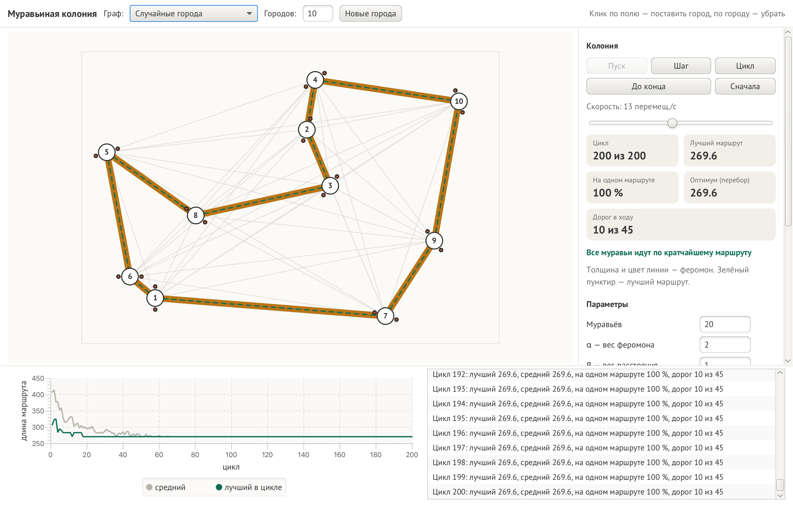

# Алгоритм муравьёв

Лабораторная работа № 4 по курсу «ООП на языке Java»: муравьиная система (Ant System)
для задачи коммивояжёра — найти кратчайший замкнутый маршрут через все города.

Муравьи обходят все города графа и возвращаются домой. Следующий путь каждый выбирает случайно,
но с вероятностью, которая растёт с **феромоном** на пути и падает с его **длиной**. Пройдя маршрут длиной L,
муравей оставляет на его путях феромон Q/L: короткие маршруты получают больше. Феромон испаряется.
Сначала феромон везде одинаковый и муравьи бегают по всем дорогам почти наугад; через несколько
десятков циклов вся колония идёт по одному маршруту — кратчайшему.



## Требования

- JDK 25
- Maven 3.9+. Отдельно ставить не обязательно: Maven встроен в IntelliJ IDEA.

Библиотеки (JavaFX 25.0.4, JUnit 6.1.3) Maven скачивает сам при первой сборке.

## Запуск

### Из IntelliJ IDEA

1. Откройте папку проекта. Если IntelliJ не предложил **Load Maven Project**,
   нажмите правой кнопкой на `pom.xml` → **Add as Maven Project**.
2. Вверху справа, в списке запусков, выберите **Окно** и нажмите ▶.
   Настройка лежит в папке `.run/`; в ней уже прописан флаг `--enable-native-access=javafx.graphics`,
   без которого Java печатает предупреждения при старте JavaFX.

### Из терминала

```bash
mvn javafx:run
```

## Как работает

**Выбор пути.** Муравей в городе r выбирает путь в ещё не посещённый город u с вероятностью

```
P(r, u) = τ(r,u)^α · η(r,u)^β / Σ по непосещённым τ^α · η^β,   η = 1 / d(r,u)
```

τ — феромон на пути, d — длина, α — вес феромона, β — вес расстояния. Когда посещены все города,
муравей идёт домой. Выбор — рулетка: случайное r из [0, 1) и первый путь, у которого накопленная
вероятность больше r.

**Обновление феромона** — после того как все муравьи закончили цикл, как в примере из задания:

```
Δτ = Q / L               за каждый проход пути муравьём с маршрутом длины L
τ  = τ + ρ · ΣΔτ          нанесение
τ  = τ · (1 − ρ)          испарение
```

Пример «два муравья» из задания (ρ 0.6, α 3, β 1, Q 10, τ₀ 0.1, пути 20 и 10) воспроизводится
до цифры: 0.1 + 0.6 · 0.5 = 0.4 и 0.1 + 0.6 · 1.0 = 0.7, после испарения 0.16 и 0.28.

**Элитные муравьи (e).** В чистой муравьиной системе колония иногда «застревает» на маршруте
чуть длиннее лучшего: лучший маршрут нашёл один муравей, и его феромона не хватает. Замер на 20 случайных
наборах городов, параметры задания (α 3, ρ 0.6, e 0): вся колония на точном оптимуме — 5 из 20
для 8 городов и 6 из 20 для 10. Поэтому есть параметр e: каждый цикл лучший найденный маршрут получает
ещё e · Q / L (стандартное расширение Дориго). С параметрами по умолчанию (α 2, β 1, ρ 0.1, e 5,
200 циклов, 2 муравья на город) — 29 из 30 для 8 городов и 27 из 30 для 10. При e = 0 алгоритм
ровно как в задании; кнопка «Как в задании» ставит его параметры.

## Окно

| Элемент | Что делает |
|---|---|
| Граф | шестиугольник из задания, «два муравья» из задания, случайные города, свои города |
| Городов / Новые города | новые случайные города, от 3 до 20 |
| Щелчок по полю | поставить город; по городу — убрать; граф становится «Свои города» |
| Пуск / Пауза | муравьи бегут сами, плавно по путям |
| Шаг | каждый муравей проходит один путь |
| Цикл | довести цикл до конца: все дома, феромон обновлён |
| До конца | все оставшиеся из M циклов |
| Сначала | феромон заново, тот же граф |
| Скорость | от 1 до 300 перемещений в секунду |
| Параметры | муравьёв, α, β, ρ, Q, τ₀, e, M; «Применить» начинает колонию заново |

Толщина и цвет линии — феромон относительно самого слабого и самого сильного пути.
Зелёный пунктир — лучший найденный маршрут. Справа: цикл, лучший маршрут, доля муравьёв на одном маршруте,
сколько разных дорог прошли муравьи за цикл и точный оптимум полным перебором (до 10 городов).
Внизу — график лучшей и средней длины по циклам и журнал циклов.

## Параметры

| Параметр | По умолчанию | В задании | Допустимо |
|---|---|---|---|
| Муравьёв | 2 на город | 2 | 1–500 |
| α — вес феромона | 2 | 3 | 0–10 |
| β — вес расстояния | 1 | 1 | 0–10 |
| ρ — нанесение и испарение | 0.1 | 0.6 | больше 0 и меньше 1 |
| Q — феромон на маршрут | 10 | 10 | больше 0, до 1000 |
| τ₀ — начальный феромон | 0.1 | 0.1 | больше 0, до 1000 |
| e — элитные муравьи | 5 | 0 | 0–100 |
| M — циклов | 200 | 100 | 1–100 000 |

Дробь можно писать через точку или запятую. Неверные поля подсвечиваются, все ошибки показываются сразу.

## Структура

```
src/main/java/aco/
├── Launcher.java             точка входа
├── model/                    среда
│   ├── Node                  узел (город) с координатами
│   ├── Path                  путь между двумя узлами: длина и феромон
│   ├── Graph                 узлы и пути, гнездо; полный граф по точкам
│   ├── Scenarios             шестиугольник, «два муравья», случайные города
│   └── Settings              α, β, ρ, Q, τ₀, e, M + проверка
├── colony/                   алгоритм
│   ├── Ant                   муравей: вероятности, выбор пути, перемещение, маршрут
│   ├── Colony                цикл колонии, феромон, испарение, статистика
│   ├── Tour, CycleStats, Hop маршрут, итог цикла, последнее перемещение
│   └── BruteForce            точный оптимум перебором
├── controller/               логика окна без JavaFX: AppController, SettingsForm, Texts, SpeedScale
└── view/                     окно JavaFX: AntApp, GraphCanvas
```

## Документы

- [Отчёт (Word)](docs/report/Отчет_ЛР4_Минязов.docx) и [PDF](docs/report/Отчет_ЛР4_Минязов.pdf); собирается скриптом `docs/report/build_report.js`
- [Презентация](docs/presentation/Презентация_ЛР4_Минязов.pptx); собирается скриптом `docs/presentation/build_presentation.js`
- UML-диаграммы (PlantUML): `docs/uml`

## Тесты

```bash
mvn test
```

80 тестов на JUnit 6, запускаются в случайном порядке. Главные проверки: формула вероятности на числах;
муравей не заходит в посещённый город и возвращается домой; пример «два муравья» даёт 0.4 и 0.7, затем 0.16
и 0.28; в первом цикле на шестиугольнике муравьи проходят не меньше 12 из 15 дорог; в конце все муравьи
идут по периметру (20 запусков из 20); на 8 случайных городах вся колония на точном оптимуме не реже 18 раз
из 20; логика кнопок, таймера и формы проверяется без открытия окна.
